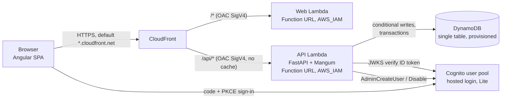

# Architecture

Smart Campus Analytics turns academic, attendance, LMS, placement, skills, engagement and feedback records
into explainable Success Scores, independent academic and placement risks, segments and tracked
interventions. Everything is rules-based and labelled as such; there is no paid AI and no predictive model
(an optional, disabled interface exists: `backend/app/model_interface.py`).

## Components



| Piece | What it is | Why |
|---|---|---|
| Frontend | Angular 21 + TypeScript, zoneless, standalone components, signals | Required stack; compiled to static files |
| Web Lambda | `backend/web_handler.py` serves the compiled app from its own ZIP; `/config.json` comes from an environment variable | No S3 bucket needed; deep links fall back to `index.html` |
| API Lambda | FastAPI (`backend/app`) with the Mangum adapter (`lambda_api.py`) | One small function, on-demand, bounded execution |
| Data | One DynamoDB table, two GSIs, provisioned 8/8 + 3/3 + 3/3 (no autoscaling) | Fixed capacity inside the always-free allowance |
| Identity | Cognito user pool, admin-created accounts only, public PKCE client, optional TOTP | No public sign-up, no SMS |
| Edge | CloudFront default domain, OAC signing both Function URLs, API caching disabled | HTTPS without a custom domain or certificate |
| IaC | `infra/template.yaml` (CloudFormation) + `infra/*.py` operator scripts | Local build, direct ZIP upload, one region |

Not used, by design: EC2, ECS, EKS, RDS, NAT gateways, load balancers, API Gateway, provisioned
concurrency, S3, WAF, custom domains, SMS, paid monitoring, paid backups, paid AI.

## Request flows

**Page load.** Browser → CloudFront → (OAC signs with SigV4) → Web Function URL (`AuthType: AWS_IAM`) → Web
Lambda returns the file. Hashed assets are `immutable` for a year; `index.html` and `/config.json` are
revalidated so a deploy is visible immediately without CloudFront invalidations.

**Sign-in (AWS).** The SPA reads `/config.json` (`mode: cognito`, hosted-login domain, client ID, redirect
URI), redirects to Cognito with an S256 PKCE challenge, receives an authorisation code, exchanges it at the
token endpoint (public client, no secret) and keeps the tokens in `sessionStorage` only.

**API call.** The SPA sends the Cognito ID token in **`X-App-Authorization`** because CloudFront's OAC
replaces `Authorization` with its own SigV4 signature. For `POST/PUT/PATCH` it serialises the body itself
and sends **`x-amz-content-sha256`** = hex SHA-256 of exactly those bytes; OAC needs it to sign bodies for
Lambda origins (CloudFront treats it as a restricted header and signs the viewer's value, so Lambda rejects
a body that doesn't match). When the header reaches the API it is verified again (`payload_hash_mismatch`).
The origin request policy forwards only `x-app-authorization`, `content-type`, `accept` and the query string. The `/api/*` behaviour uses the managed *CachingDisabled* policy and every
API response carries `Cache-Control: no-store, private`.

**Authorisation.** The API validates the token (RS256 signature against the pool's JWKS, issuer, expiry,
`token_use = id`, audience = the app client), then loads the user's assignments from DynamoDB
(`USER#{sub}` → `PROFILE`, `ROLE#…`, `MENTEE#…`, `SUBJ#…`). Roles in the token or sent by the browser are
ignored. Every operation goes through `policy.py`, which evaluates `config/role-matrix.json`:
resource · action · scope · fields. Field filtering removes what a role may not see (for example a
Placement Officer sees only placement and skills components; students never see staff notes).

**Writes.** Every data change is a DynamoDB transaction that writes the record (conditional on the
expected `version`, so concurrent edits fail with 409 instead of overwriting) together with a `STALE`
marker for the student. The API then recalculates that student; if recalculation fails the marker stays
and the profile says "recalculation pending" until an administrator runs *Repair* (bounded, resumable).

## Security summary

* Function URLs accept only SigV4-signed calls from this distribution (`lambda:InvokeFunctionUrl` **and**
  `lambda:InvokeFunction` with `InvokedViaFunctionUrl`, each with `SourceArn` = the distribution). Direct
  calls get 403 (checked by `infra/smoke_test.py`).
* Local demonstration sign-in (`AUTH_MODE=local-demo`) exists only for development. The API refuses to
  start inside Lambda in any other mode than `cognito` (cold-start check in `lambda_api.py`), the template
  hard-codes `AUTH_MODE: cognito`, and `deploy.py` refuses packages that could enable a bypass.
* No passwords, tokens or secrets in the repository. Temporary passwords are printed once by
  `infra/setup_accounts.py`. The audit log records who did what, never sensitive values (feedback comments,
  notes, tokens); application logs never include request bodies or tokens.
* Separation of duties: the System Administrator manages accounts and roles but has no student-data
  access, can't hold a student-data role, and nobody can change their own roles.
* Content-Security-Policy, HSTS, `X-Frame-Options: DENY`, `nosniff` and `no-referrer` on every page.

## Datasets

All records live in one dataset (`real`). The key is part of every partition key and API path so a separate
dataset could be added later without a data migration; today only `real` is served.

## Code map

```
backend/app/        settings, store (DynamoDB + SQLite emulation), keys, policy, auth, categories,
                    recordsvc, imports, scoring (pure), insights (recalculation), interventions,
                    accounts, audit, views (read models), seed, model_interface (disabled), main (routes)
backend/lambda_api.py, web_handler.py      Lambda entry points
backend/local_server.py                    local development only (never packaged)
frontend/src/app/   core (auth, interceptor, api, session, guards), shared (charts, filters), pages (15 screens)
config/             role-matrix.json (canonical), scoring.json, curriculum.json
infra/              template.yaml, preflight, deploy, setup_accounts, smoke_test, rollback, teardown
e2e/journey.mjs     end-to-end journey (Playwright)
```

See also: [data dictionary](data-dictionary.md), [API](api.md), [scoring and risk](scoring-methodology.md),
[role matrix](role-matrix.md), [cost and preflight](aws-cost-and-preflight.md), [deployment](deployment.md).
